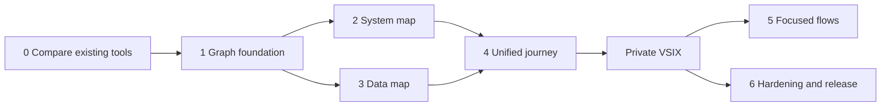

# Archi implementation plan

This plan expands [PLAN.md](PLAN.md). Research date: 2026-10-30. Marketplace descriptions below are vendor claims; Phase 0 checks the actual user journey on HBEC before implementation begins.

## Existing extensions and the gap

| Extension | What its listing says it does | Relevance to Archi |
| --- | --- | --- |
| [Context Graph](https://marketplace.visualstudio.com/items?itemName=context-graph.context-graph) | Local Python/JS/TS architecture, module and symbol dependencies, call flow, evidence inspection, source navigation, automatic refresh | Strong overlap with our proposed component map. Do not build a generic import/call graph first. |
| [ArchLens](https://marketplace.visualstudio.com/items?itemName=AhsanulHoque.solution-architecture-diagram) | Repository-level service map; local Compose/manifests quick scan or Copilot-assisted generation; editable component files | Strong overlap with system overview. Its own listing says links are inferred from mentions/config and need review; no data model view is described. |
| [Tecture](https://marketplace.visualstudio.com/items?itemName=Tecture.tecture-vscode) | Multi-level architecture diagrams from agent-maintained architecture files, persistent layout | Good presentation reference. Its listing describes a documentation-first workflow, not direct automatic extraction of an evidence graph. |
| [Django ORM Lens](https://marketplace.visualstudio.com/items?itemName=frowningdev.django-orm-lens) | Static Django model parsing, live ER diagram, source jumps | Strong Django-only data-map alternative. |
| [Tablur](https://marketplace.visualstudio.com/items?itemName=Tablurio.tablur-vscode-ext) | Interactive ER diagrams for Django, SQLAlchemy, and other ORMs | Strong data-map alternative; its listing describes schema design/editing and plan limits. It does not describe a unified service-to-data architecture map. |
| [Docker Compose to Mermaid](https://marketplace.visualstudio.com/items?itemName=TamirTapiro.dc2mermaid-vscode) | Live Compose topology rendered as Mermaid | Useful narrow baseline for service discovery. |
| [Atomic Viz](https://marketplace.visualstudio.com/items?itemName=AtomicConcepts.atomicviz) | Language-server-backed code graph and call hierarchy with source jumps | Another strong component-level alternative. |

**Decision:** Archi is worth building only if it makes the cross-layer journey materially better than using a system-map extension plus an ER extension. Its distinctive path is **system -> service -> owned database -> domain entities -> physical tables**, with the same evidence and source-navigation model throughout. Generic call graphs, schema editing, and AI-drawn diagrams are not initial differentiators.

## Phase 0 — Validate the opportunity on HBEC

**Work**

1. Install or inspect Context Graph, ArchLens, Django ORM Lens, and Tablur in a disposable VS Code profile. Analyze HBEC without editing it.
2. Record a short comparison for three tasks: identify service-to-service links, trace a service to its owned data, and inspect a Django plus SQLAlchemy relationship. Note setup effort, missed/incorrect edges, readability, and source navigation.
3. Create a manually reviewed HBEC reference set: 10–15 service edges, 10 Django relations, 10 SQLAlchemy relations, and their source locations. Include ambiguous cross-service IDs and blue/green deployment variants as negative cases.
4. Decide whether Archi should be built, narrowed to a bridge between existing tools, or stopped. If existing tools already satisfy the cross-layer journey, stop before creating a competing extension.

**Exit gate:** A written comparison and reference set demonstrate at least one important HBEC journey that available extensions do not handle well enough.

## Phase 1 — Extension shell and evidence graph

**Status (2026-10-30): implemented and validated locally.** The fixture diagram exercises the extension host, bounded workspace scan, local workspace-state cache, typed graph validation, source navigation, and webview messaging. It deliberately contains no architecture inference yet. `npm run lint`, `npm test`, and `npm run test:extension` pass. The extension-host test verifies scanning, cancellation, workspace path boundaries, and diagram-tab creation; a manual click-through remains useful before Phase 2 UI work.

**Work**

- Create the TypeScript VS Code extension scaffold, build/test/lint scripts, extension-host test harness, and a minimal command that opens an empty diagram webview.
- Define versioned graph types: node, edge, containment, source evidence, confidence, extractor diagnostic, and stable ID. Separate facts from view preferences.
- Implement workspace selection, default exclusions, cancellation, progress reporting, scan limits, and local cache. Keep analyzed files read-only.
- Implement safe webview messaging and an **Open source** action for a known graph fixture.

**Exit gate:** Fixture graph renders; node/edge source jumps open exact files and lines; cancellation works; invalid graph messages cannot invoke arbitrary commands or read paths outside opened workspace folders.

## Phase 2 — Service architecture vertical slice

**Status (2026-10-30): implemented and validated on HBEC.** See [PHASE2_REVIEW.md](PHASE2_REVIEW.md) for the production/dev extraction counts, sampled source-backed links, and known omissions. The extension-host journey passes with HBEC open; parser and webview interaction tests pass. Gateway routes remain outside the available Compose evidence.

**Work**

- Parse Compose structurally: services, `depends_on`, networks, environment URL references, databases, Redis, and gateway routes where supported.
- Normalize deployment instances into logical services. Explicit configuration decides grouping; user overrides handle ambiguous cases.
- Render a small system map with searchable nodes, typed edges, evidence panel, and expand/focus controls. Use a deterministic layout and preserve positions on refresh.
- Show inferred or unresolved connections distinctly. Never convert a shared network or naming similarity into a proven call.

**Exit gate:** On HBEC, the default view shows logical student, admin, harness, notifications, payments, and schools areas plus shared infrastructure; blue/green variants do not dominate. Every visible factual edge opens its evidence. Compare output against Phase 0's reference edges and record false positives and omissions.

## Phase 3 — Data architecture vertical slice

**Status (2026-10-30): implemented and validated on HBEC.** See [PHASE3_REVIEW.md](PHASE3_REVIEW.md) for the reference relationships, negative cases, extraction counts, and unresolved targets. The data view supports service and app scope, domain and physical modes, source jumps, and model-file diagnostics. The unified system-to-table navigation remains Phase 4 work.

**Work**

- Parse Django `ForeignKey`, `OneToOneField`, `ManyToManyField`, `Meta.db_table`, string and `self` references, and common split-model packages without importing Django.
- Parse SQLAlchemy declarative tables, `ForeignKey`, and explicit `relationship`/`secondary` patterns without importing project modules. Mark dynamic patterns unresolved.
- Map each model/table to its owning service and database from explicit configuration where possible. Keep cross-database identifiers as logical references, not physical foreign keys.
- Provide **domain** and **physical** data modes; collapse join tables only in domain mode. Show keys and selected columns on demand.

**Exit gate:** Phase 0's 20 reference relations have correct endpoints and types, with source jumps. Negative cases do not become foreign keys. A broken model file yields a diagnostic while unaffected models still render.

## Phase 4 — Unified navigation and useful abstraction

**Status (2026-10-30): implemented and validated on HBEC.** See [PHASE4_REVIEW.md](PHASE4_REVIEW.md). A service node in the system map with owned model data now offers **Explore data**, scoped to that service; a table or model in the data map with a matching Compose service offers **Open in system map**. A breadcrumb trail and **Back** button unwind either direction. Hidden nodes, renamed labels, pinned (dragged) positions, the active view mode, and filter choices persist to `.archi/views/default.json` in the first workspace folder and are restored on reanalysis; facts themselves are always regenerated, never read back from that file. A node-budget warning appears instead of silently dropping nodes once the default (ungrouped, unfocused) system view exceeds 60 components. A coverage line above the diagram now reports total nodes/edges plus unresolved-relationship and skipped-file counts drawn from existing diagnostics.

**Work**

- Link system and data views through the common graph: open a service, see its databases and model domains, then inspect a table or relation and return by breadcrumb.
- Add grouping rules, edge aggregation, filters, search, and scoped views. Use an explicit node budget for the default canvas and offer expansion instead of silently hiding facts.
- Save only view preferences (labels, grouping, filters, pinned positions) in `.archi/views/`; keep facts generated. Support multi-root workspaces with clear ownership labels.
- Add a diagnostic panel for unresolved relationships, skipped files, and extractor coverage.

**Exit gate:** A fresh HBEC user can complete the system-to-table journey without manually matching names across two diagrams. Reanalysis preserves presentation choices; changing source updates facts without overwriting those choices.

**MVP release gate:** Phases 0–4 pass. Package a private VSIX and run the extension in a normal VS Code desktop window with HBEC open. This is the first version worth using regularly. **Status (2026-10-30):** the VSIX packages cleanly (`npm run package`, dependency-pruned via `.vscodeignore`) and installs; the manual HBEC desktop click-through itself needs a real GUI session and is tracked as pending with the user rather than claimed here.

## Phase 5 — Component and request-flow tracing

**Status (2026-10-30): implemented and validated on HBEC.** See [PHASE5_REVIEW.md](PHASE5_REVIEW.md). A new **Flows** view resolves each Django service's declared routes (two-pass `config/urls.py` → app `urls.py` composition, following `include()` across files) and Celery tasks (`@shared_task`/`@app.task` definitions linked to their `.delay()`/`.apply_async()` call sites by symbol, including the explicit-`name=` case). Both are scoped per service, source-linked, and reachable from a system-map service node via **Explore flows**, with **Back** unwinding to the system map. JS/TS client-call extraction (resolving a frontend `fetch`/`axios` call to a specific backend route) was explicitly scoped out of this phase rather than attempted with regex, since it would need a proper JS parser; the existing Compose-level service-to-service HTTP edges plus the new per-service route list already let a user follow an HTTP path across layers, which satisfies this phase's exit gate without it.

**Work**

- Add Python and JS/TS import/route/client extractors only where they improve a cross-layer path that Phase 0 found missing. Prefer editor/language-service data where it is reliable.
- Build focused route and event views, not a full-workspace call graph. Label source-backed hops and gaps.
- Keep the system and data maps usable when one language extractor fails or is unavailable.

**Exit gate:** At least two HBEC paths (one HTTP, one event or queue path) can be followed through supported layers with source links and honest gaps. Component-level work must outperform simply opening Context Graph for the same task.

## Phase 6 — Quality and distribution

**Status (2026-10-30): implemented and validated.** See [PHASE6_REVIEW.md](PHASE6_REVIEW.md). HBEC cold/warm benchmarks are recorded with a release budget; a real accessibility defect (`role="img"` flattening the diagram's interactive children) was found and fixed; Mermaid/SVG/PNG export shipped with secret-safe labels verified by construction (the Compose secret-value filter already keeps anything sensitive off the graph) and PNG verified in a real browser context; a small self-contained example workspace was added at `examples/sample-workspace`. The `tinomupezeni` publisher is registered and version 0.1.0 is published. Version 0.1.1 packages a user-focused Marketplace README with three screenshots; GitHub Actions Trusted Publishing policy setup remains optional for future automated releases. The MVP release gate's manual VS Code desktop click-through remains pending.

**Work**

- Benchmark a cold and warm HBEC scan; set release budgets from measured file count, duration, peak memory, and canvas responsiveness. Optimize only measured bottlenecks.
- Test keyboard navigation, themes, zoom, accessible labels, and large-diagram behavior. Test Restricted Mode and remote/virtual workspace support according to declared capabilities.
- Add Mermaid, SVG, and PNG export with secret-safe labels, plus documentation and a small example workspace.
- Decide packaging, licensing, Marketplace listing, and whether any optional AI summaries should be built. AI remains opt-in and cannot add factual graph edges without evidence.

**Exit gate:** Extension-host tests, static checks, HBEC manual journey, accessibility checks, and VSIX installation pass. Release notes state supported extractors and known blind spots.

## Dependency order and implementation rule

The graph contract and evidence model come first. Extractors, projection, and rendering remain separate so one language can be added without rewriting the UI. Each phase ends with a working HBEC journey and a recorded comparison to the Phase 0 reference set.

## Validation commands once the scaffold exists

`npm run lint`, `npm test`, `npm run build`, and `npm run test:extension`. Run the extension-host test with `ARCHI_TEST_WORKSPACE=/home/shadowe/Projects/HBEC` to verify HBEC. Phase 4 adds a manual HBEC walkthrough and VSIX install; Phase 6 adds benchmark and accessibility runs.
