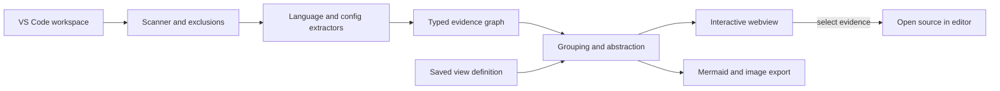

# Archi: code-to-diagram VS Code extension

For phase gates and the existing-extension comparison, see [IMPLEMENTATION_PLAN.md](IMPLEMENTATION_PLAN.md).

## Objective

Make an unfamiliar codebase understandable through navigable, source-backed diagrams. A user opens a workspace, runs **Archi: Analyze Workspace**, sees a readable system map, and can drill into a service, module, or database domain without losing the connection to the code.

The pilot workspace is `/home/shadowe/Projects/HBEC`. It contains multiple Django services, FastAPI/SQLAlchemy services, React clients, Docker Compose wiring, PostgreSQL databases, Redis, and migrations. The extension itself lives in this `Archi` workspace; HBEC is a read-only test fixture during development.

## Product contract

| View | Question it answers | Initial evidence |
| --- | --- | --- |
| System map | What runs, and what talks to what? | Compose services, networks, environment references, client API bases, routes |
| Component map | What modules belong to a service, and how do they depend on each other? | Imports, route registration, calls where statically resolvable |
| Data map | What entities exist, and how are they related? | Django model fields, SQLAlchemy relationships and foreign keys, migration metadata |

Every node and edge has a stable ID, source location(s), extraction method, and confidence class: **declared**, **statically inferred**, or **unresolved**. A diagram must never silently turn a naming convention, URL string, or cross-service ID into a database foreign key. Unsupported links are omitted or shown as a distinct unresolved relationship.

### Abstraction rules

1. Default to a small system map: group replicas, workers, and infrastructure by logical service; do not draw every file or Compose container.
2. Expand one level at a time: system -> service -> module -> symbol or table. Preserve a breadcrumb and a way back.
3. Show only relationships relevant to the selected level. Aggregate repeated edges and expose their count and evidence on click.
4. Use semantic groups from explicit evidence first: Compose service, Python app/package, database boundary, and user-configured domain. Allow users to rename or regroup without changing extracted facts.
5. Separate **physical schema** (tables, columns, foreign keys) from **domain view** (chosen entities and concepts). A many-to-many join table may be collapsed in the domain view while remaining visible in the physical view.
6. Keep the layout stable across refreshes and make filters (relation type, confidence, ownership, search) visible.

## User journey

1. Run **Archi: Analyze Workspace** on an open folder. The extension reports progress and skipped files.
2. Open **System Map**. Pan, zoom, search, filter, and select a node or connection to see its explanation and source links.
3. Choose **Explore component** or **Explore data** from a node. A scoped diagram opens with a breadcrumb to the parent.
4. Click **Open source** to jump to the exact file and line. Refresh after edits, or let a debounced watcher update affected parts.
5. Save an editable view definition (scope, grouping, hidden nodes, labels, pinned positions) in `.archi/views/`. Export a snapshot as Mermaid and SVG/PNG. Generated facts are regenerated; user layout and presentation choices persist.

## Architecture

- **Extension host, TypeScript:** commands, workspace file access, cancellation, caching, watcher, source navigation, and export.
- **Extractors:** small adapters that emit a common graph contract. Start with Docker Compose, Python imports, Django models, SQLAlchemy models, and JS/TS imports and API endpoints. Prefer AST/parser or structured configuration parsing to broad regex. A failed adapter must leave the rest of the graph usable.
- **Graph core:** nodes (`service`, `module`, `symbol`, `database`, `table`, `domain`) and typed edges (`calls`, `imports`, `serves`, `publishes`, `consumes`, `reads`, `writes`, `foreign_key`, `many_to_many`). Store evidence URI, range, extractor, and confidence on every edge. Cross-database links are service/data-flow edges, never physical foreign keys.
- **View engine:** produces a scoped graph and deterministic grouping, filtering, edge aggregation, and layout input from the graph. It has no parser-specific logic.
- **Webview:** an interactive node-edge canvas with details panel, breadcrumbs, keyboard support, and VS Code theme colors. Use React Flow for interaction and a layout engine for initial positions; keep rendering independent from extraction. Mermaid is an export format, not the canonical model.
- **Local-first:** analysis runs locally. An optional later AI layer may suggest domain labels or summaries from selected evidence. It cannot create accepted factual edges without source evidence, and sending code to a provider requires explicit opt-in.

## Pilot extraction order

1. **Compose and service boundaries.** Normalize blue/green instances and worker/beat processes into logical services. Identify database, Redis, gateway, and service URL connections. Show explicit vs inferred edges.
2. **Data relationships.** Parse Django `ForeignKey`, `OneToOneField`, `ManyToManyField`, and SQLAlchemy `ForeignKey`/`relationship`; resolve table names and cardinality where explicit. Partition by database/service.
3. **Module dependencies.** Parse Python and JS/TS imports, route registrations, and client API bases. Summarize at package level before symbol-level work.
4. **Focused flows.** Trace selected HTTP routes or event names across services only where code/config evidence permits. Show gaps instead of inventing the missing hop.

## MVP acceptance criteria

- Given HBEC opened in VS Code, when analysis completes, the default diagram shows logical student, admin, harness, notifications, payments, and schools areas plus shared infrastructure, without a separate top-level node for each blue/green instance.
- Given a displayed service connection, when selected, the details panel shows relationship type, confidence, and at least one navigable source location. If the source cannot establish a link, the map does not present it as a fact.
- Given an HBEC Django curriculum model, when **Explore data** is opened, declared foreign-key and many-to-many relationships appear with correct direction and cardinality; clicking one opens its defining model field.
- Given an HBEC SQLAlchemy model, when **Explore data** is opened, supported foreign keys appear; unsupported dynamic relationships are reported as unresolved, not fabricated.
- Given a diagram with many nodes, when the user chooses a scope or filter, the view becomes readable without deleting the underlying graph. Refresh preserves saved grouping, labels, and pinned positions.
- Given ignored or generated directories (`.git`, `node_modules`, build output, virtual environments, media), scanning skips them by default. The user can cancel analysis. No workspace code or secrets leave the machine by default.
- Given an invalid or partially parsed file, the extension completes with a visible diagnostic and produces all unaffected diagrams.

## Work units and evidence

The [implementation plan](IMPLEMENTATION_PLAN.md) begins with an HBEC comparison against existing extensions, then builds the graph foundation, system map, data map, and unified navigation. That unified journey is the first private VSIX release gate. Focused component and flow tracing follow only where existing tools leave a demonstrated gap.

## Engineering constraints

- Scan only opened workspace folders. Do not recursively search sibling projects without the user opening or explicitly adding them.
- Parse source and configuration as data; do not execute project code, import project modules, run migrations, or connect to databases for the MVP.
- Use VS Code workspace APIs where possible for remote/virtual filesystems. Declare Restricted Mode behavior and gate any future external command or AI provider feature on Workspace Trust.
- Keep the graph cache in extension storage; put only intentional view definitions in the repository. No secrets, file contents, or credentials in exports or logs.
- Make scanner limits configurable and benchmark on HBEC before setting a release performance target. Record files scanned, skipped, unresolved edges, elapsed time, and peak memory locally without sending telemetry.
- Validate with `npm test`, `npm run lint`, `npm run build`, VS Code extension-host integration tests, and a manual HBEC analysis journey once those commands exist. Target environment: local VS Code desktop with HBEC opened as a workspace.
- Rollback is uninstalling/disabling the extension; removing `.archi/views/` removes only user-saved diagram preferences. The extension does not modify analyzed source.

## Open decisions

1. Whether optional AI summaries should use a user-supplied provider, a local model, or VS Code's language-model API. This does not block the local-first MVP.
2. Whether to ship private workspace-only use first or prepare for Marketplace publication; this affects packaging, licensing, and support policy, not the graph design.
3. Whether shared views should be committed to each project (`.archi/views/`) or stored only in VS Code user storage by default.
