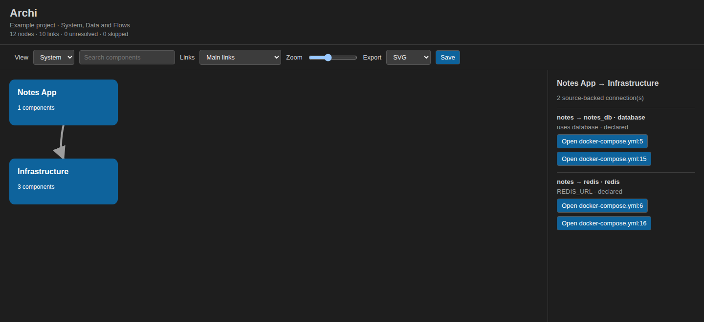

# Archi

**Understand how a codebase fits together.** Archi turns project configuration and source declarations into diagrams you can explore directly in VS Code: services, data models, routes, and background tasks.

Archi helps answer questions such as:

- Which services depend on each other, and which databases or caches do they use?
- Which models are connected, and which service owns them?
- Which routes and background tasks belong to an application?
- Where in the source is a diagram connection declared?

The diagrams are interactive and source-linked. Select a component or connection to inspect it, then open the source location behind it.

## See Archi in action

These screenshots use the included sample workspace.

### System map

See the application, database, and cache relationships in one view.



### Data map

Explore Django and SQLAlchemy models in domain or physical table view. Follow declared relationships and jump to the field that defines them.


### Flows

Browse Django routes and Celery tasks by service and app, with source links to their declarations.


## Get started

1. [Install Archi from the Visual Studio Marketplace](https://marketplace.visualstudio.com/items?itemName=tinomupezeni.archi).
2. Open a project folder in VS Code.
3. Run **Archi: Analyze Workspace** from the Command Palette.
4. Choose **System**, **Data**, or **Flows** above the diagram. Select a service or app to narrow the view.

Archi uses Docker Compose files for the system map and service ownership. If a project has more than one Compose file, use **Archi: Select Compose File** to choose one. Without Compose, Archi can still show a data map for discovered model files.

Try the [included sample workspace](examples/sample-workspace) if you want to explore the views without opening another project.

## What Archi reads

- **System:** Docker Compose services and declared HTTP, Redis, database, and startup-dependency links.
- **Data:** Django models and common SQLAlchemy declarative models, including foreign keys, one-to-one links, and many-to-many relationships.
- **Flows:** Django URL patterns and Celery task declarations and trigger sites.

Click a connection to inspect its evidence. Move between a service and its data or flows, filter and search the diagram, and export the current view as SVG, PNG, or Mermaid. Archi can also remember diagram labels, visibility, and positions in `.archi/views/default.json`.

## Local analysis

Archi reads files in open workspace folders. It parses source as data: it does not execute project code, run migrations, connect to a database, or send source to an external service. Since extraction is static, dynamic model names, routes, and relationships may not appear; unresolved references are reported rather than guessed.

## Develop Archi

```sh
npm install
npm run build
npm run lint
npm test
npm run test:extension
```

See [Contributing](CONTRIBUTING.md) to work on Archi and [Adding an extractor](docs/ADDING_AN_EXTRACTOR.md) to add language support. Archi is open source under the [MIT License](LICENSE).
