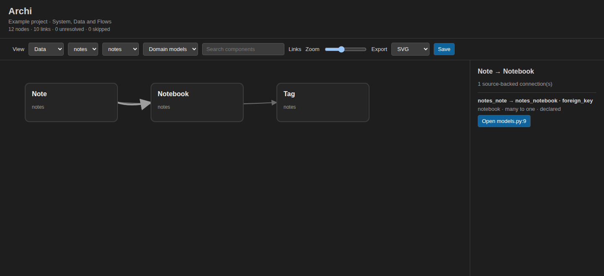
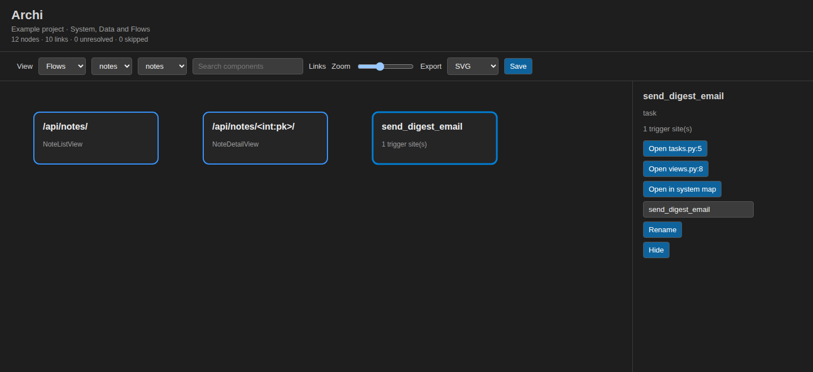

# Archi

**Interactive Architecture Studio & Design Critic for VS Code.** Archi bridges specification and implementation: turn Product Requirements Documents (PRDs) into interactive diagrams, experiment with alternative component topologies with instant and AI-assisted health critiques, and extract source-backed architecture maps directly from code.

Archi helps answer questions such as:

- How should the system be structured based on a PRD or design specification?
- What are the security vulnerabilities, single points of failure (SPOFs), or cyclic bottlenecks in a proposed topology?
- Does the actual running codebase match the architectural specification (conformance & drift)?
- Which services depend on each other, and which databases or caches do they use?
- Where in the source or specification is a connection declared?

The diagrams are interactive, malleable, and source-linked. Select a component or connection to inspect it, rewire relationships, run AI critiques, or scaffold Docker Compose and Architecture Decision Records (ADRs).

## See Archi in action

### 1. Interactive Architecture Studio & PRD Synthesis

Feed any PRD or technical specification into Archi. Powered by your active coding agent (**Google Antigravity**, **Claude Code**, **GitHub Copilot**, or **Codex**), Archi synthesizes components, directed protocols, and links back to exact PRD lines.

- **Interactive Playground:** Add components (`+ Component`), rewire links (`↔ Connect`), or delete elements.
- **Instant Health & Security Linter (<50ms):** Automatically flags direct database exposure, cyclic sync deadlocks, and un-replicated bottlenecks with a live 0–100 Health Score.
- **Deep AI Architecture Critique:** On-demand Principal Systems Architect evaluation delivering Security, Scalability, and Reliability verdicts with actionable recommendations.
- **Spec-to-Code Conformance & Drift:** Compare your PRD design against extracted code to find missing services and undocumented shadow infrastructure.
- **Downstream Scaffolding:** One-click export to `docker-compose.archi.yml` and `ADR-architecture-decision.md` with embedded Mermaid flows.

### 2. Codebase Architecture Extraction

These screenshots use the included sample workspace.

#### System map

See application, database, and cache relationships in one view with Compose service normalization.


#### Data map

Explore Django and SQLAlchemy models in domain or physical table view. Follow declared relationships and jump to the field that defines them.



#### Flows

Browse Django routes and Celery tasks by service and app, with source links to their declarations.



## Get started

1. Install Archi in VS Code (or package via `npm run package` and install the VSIX).
2. Open a project folder in VS Code.
3. Select the **Archi icon in the Activity Bar** (sidebar) and choose:
   - **Analyze this workspace**: Static extraction from Docker Compose, Django/SQLAlchemy models, routes, and tasks.
   - **Design from PRD**: Select any PRD or spec markdown file to synthesize an interactive diagram via your connected agent.
   - **Open last diagram**: Re-open your cached diagram layout.
4. In the diagram webview:
   - Rearrange nodes and inspect the live **Architecture Health Score**.
   - Click **Deep AI Critique** for a multi-dimensional security and scalability assessment.
   - Click **Spec Drift** to check conformance against your codebase.
   - Use **Save** to export as SVG, PNG, Mermaid, Docker Compose, or ADR Markdown.

## What Archi reads

- **PRD Documents:** Markdown/text specifications analyzed via `vscode.lm` or CLI agents (`agy`, `claude`, `copilot`, `codex`).
- **System:** Docker Compose services and declared HTTP, Redis, database, and startup-dependency links.
- **Data:** Django models and common SQLAlchemy declarative models, including foreign keys, one-to-one links, and many-to-many relationships.
- **Flows:** Django URL patterns and Celery task declarations and trigger sites.

## Develop Archi

```sh
npm install
npm run build
npm run lint
npm test
npm run package
```

See [Contributing](CONTRIBUTING.md) to work on Archi and [Adding an extractor](docs/ADDING_AN_EXTRACTOR.md) to add language support. Archi is open source under the [MIT License](LICENSE).
